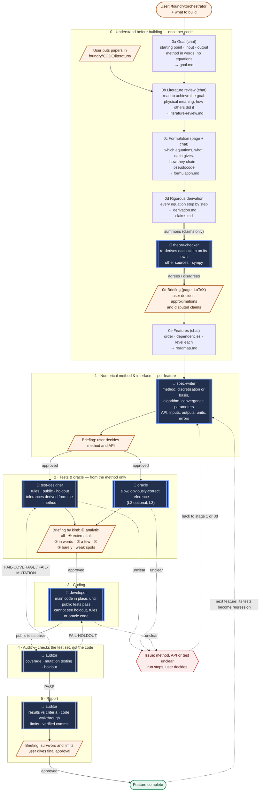

# foundry

A scientific code development plugin for Claude Code, verification-first.
Built for scientific codes (especially for materials science and condensed matter physics).

You describe the code you want; foundry first works out the physics and the equations with you, then builds the code feature by feature — each with its own tests, an independent reference where needed, and an audit of the tests themselves. You take part through short briefings and decide only what has no correct answer.

## Install
In Claude Code:
```
/plugin marketplace add chaewoon11/foundry
/plugin install foundry@sci-workflows
```
From a shell (also for a cloud environment's setup script):
```bash
claude plugin marketplace add chaewoon11/foundry
claude plugin install foundry@sci-workflows -y
```
While the plugin lives on the `dev` branch, add the marketplace as `https://github.com/chaewoon11/foundry.git#dev` instead.

For a whole repository, `claude plugin marketplace add <source> --scope project` and `claude plugin install foundry@sci-workflows --scope project` write `.claude/settings.json`; commit it, and every session in that repository has foundry.

Then, in a project, the user says "foundry로 ~ 하자" or runs `/foundry:orchestrator <what to build>`.

## How a run goes

Every box is one markdown file in this repository — see the table below.



Orange = the user · 🤖 dark boxes = agents the orchestrator summons · green = a feature is done · dashed = going back.

## Step files

Each step is driven by one skill (the orchestrator reads it) and, for 🤖 steps, an agent's instructions. Click to read.

| Step | Skill (read by the orchestrator) | Agent |
|---|---|---|
| Orchestrator — runs the whole workflow | [`orchestrator`](plugins/foundry/skills/orchestrator/SKILL.md) · [rules](plugins/foundry/skills/orchestrator/RULES.md) · [workflow](plugins/foundry/skills/orchestrator/WORKFLOW.md) | — |
| **0a** Goal — starting point, input, output, method in words | [`goal`](plugins/foundry/skills/goal/SKILL.md) | — |
| **0b** Literature review — physical meaning, how others did it | [`literature`](plugins/foundry/skills/literature/SKILL.md) | — |
| **0c** Formulation — equations, how they chain, pseudocode | [`formulation`](plugins/foundry/skills/formulation/SKILL.md) | — |
| **0d** Rigorous check — derivation, independent re-derivation | [`theory-check`](plugins/foundry/skills/theory-check/SKILL.md) | [🤖 `theory-checker`](plugins/foundry/agents/theory-checker.md) |
| **0e** Features — order, dependencies, level each | [`features`](plugins/foundry/skills/features/SKILL.md) | — |
| **1** Numerical method & interface | [`method`](plugins/foundry/skills/method/SKILL.md) | [🤖 `spec-writer`](plugins/foundry/agents/spec-writer.md) |
| **2** Tests & oracle | [`tests`](plugins/foundry/skills/tests/SKILL.md) | [🤖 `test-designer`](plugins/foundry/agents/test-designer.md) · [🤖 `oracle`](plugins/foundry/agents/oracle.md) |
| **3** Coding | [`coding`](plugins/foundry/skills/coding/SKILL.md) | [🤖 `developer`](plugins/foundry/agents/developer.md) |
| **4** Audit — checks the test set, not the code | [`audit`](plugins/foundry/skills/audit/SKILL.md) | [🤖 `auditor`](plugins/foundry/agents/auditor.md) |
| **5** Report — final approval, next feature | [`report`](plugins/foundry/skills/report/SKILL.md) | [🤖 `auditor`](plugins/foundry/agents/auditor.md) |
| Briefing — used by 0d, 1, 2, 5 | [`brief`](plugins/foundry/skills/brief/SKILL.md) | — |

## What the user does
1. **Starts it** with `/foundry:orchestrator`, or says "foundry로 ~ 하자".
2. **Talks it through** in stage 0: the goal, the literature, the frame of the calculation, the features.
3. **Answers briefings**: a page shows the big picture (equations in LaTeX); the user decides only what has no correct answer — approximations, method, API, trade-offs between rigour and cost — and approves the agents' decisions as one list.
4. **Decides when asked**: the run otherwise moves on by itself, and stops only for a briefing, an issue an agent found, or a failed audit.

## Why it is built this way
- **Understand before building.** Code and tests are both built from the equations; if an equation is wrong, both are wrong and every test passes. Stage 0 settles the physics and has every equation re-derived independently before any code exists.
- **Separate agents, separate views.** The test designer and the oracle never see the code; the developer never sees the hidden tests or the oracle's code; the theory checker never sees the derivation it checks. One misunderstanding cannot end up in both sides.
- **Audit the tests, not just the code.** Bugs are planted on purpose; if the tests do not catch them, the tests are too weak.
- **One feature at a time.** Each finished feature's tests guard every later one.

## Information barriers
A hook (`hooks/guard.py`, rules in `hooks/policy.json`) checks every file access of every foundry agent. The main code's paths come from `foundry/<code>/foundry.json`, written in stage 0a.

| Agent | Cannot see | Can write |
|---|---|---|
| theory-checker | `theory/derivation.md`, main code, oracle, features | `theory/checks/` |
| spec-writer | main code, oracle, tests, audit | `method.md`, `REVIEW-method.md` |
| test-designer | main code (may run it, not read it), oracle, audit | `tests/`, `REVIEW-tests.md` |
| oracle | main code, tests, audit | `reference/` |
| developer | holdout, test rules and generators, oracle, audit details, git history | main code; new files in `tests/regression/` |
| auditor | — | `audit/` |

The main session is not restricted. Shell commands are checked by their text, so the barrier stops an agent from wandering into a file, not a determined attempt to get around it.

## Verification levels (chosen per feature)

| | L1 | L2 | L3 |
|---|---|---|---|
| Tests | analytic + transformations | + consistency, order or oracle | all kinds |
| Holdout (hidden tests) | none | some | all |
| Oracle | none | optional | required |
| Mutation testing | none | key steps, ≥ 70 % | all steps, ≥ 90 % |

## What a run leaves in a project
```
<project>/
  <main code>                  developed in place, never inside foundry/
  foundry/<code>/
    foundry.json               main-code paths (for the barrier)
    goal.md · literature/ · literature-review.md · formulation.md
    theory/                    derivation.md · claims.md · checks/ · REVIEW.md
    roadmap.md
    reference/                 the oracle (shared by features)
    features/<feature>/        method.md · tests/ · audit/ · REVIEW-<stage>.md · pages/
```

## License
MIT
